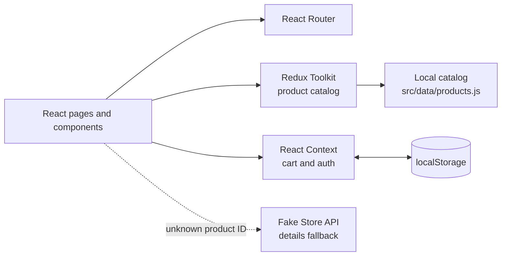

<div align="center">

# Sprintix
### Sports gear. Built for the next move.

A responsive sports storefront for discovering gear, exploring product details, and managing your shopping bag.

<br />


<br />

[Explore the features](#-features) · [Get started](#-getting-started) · [Project structure](#-project-structure)

</div>

---

## ✨ Features

- **Discover the collection** with a responsive storefront and product catalog.
- **Find the right gear** with category filters, text search, and price or rating sorting.
- **Explore product details** with quantity controls and add-to-bag actions.
- **Manage your shopping bag** with quantity updates, item removal, and saved cart state.
- **Sign in or create an account** with client-side form validation.
- **Navigate seamlessly** with React Router and direct-route support on Vercel.

## 🧭 How the app is organized



The catalog is local-first: the product list is loaded from `src/data/products.js` through a Redux Toolkit async thunk. The Fake Store API is used by the product details page only when the requested ID is not in the local catalog.

| State area | Implementation | Responsibility |
| --- | --- | --- |
| Product catalog | Redux Toolkit | Loads the local catalog and tracks loading/error state |
| Shopping bag | React Context | Cart actions, quantities, totals, and `localStorage` persistence |
| Authentication | React Context | Demo user state persisted in `localStorage` |

> **Demo authentication:** Sign-in and sign-up are client-side demonstrations. There is no backend authentication, and the app does not verify credentials with a server.

## 🛠️ Tech stack

| Area | Tools |
| --- | --- |
| UI | React 18, JSX |
| Build and development | Vite 8 |
| Routing | React Router DOM 7 |
| State | Redux Toolkit, React Redux, React Context |
| HTTP | Axios |
| Styling | CSS |
| Hosting configuration | Vercel |

## 🚀 Getting started

### Requirements

- Node.js compatible with Vite 8
- npm
- Git

### Install and run

```bash
git clone https://github.com/MoustafaFathalla2005/first-project-react.git
cd first-project-react
npm install
npm run dev
```

Vite prints the local development URL in the terminal (usually `http://localhost:5173`).

## 📜 Available scripts

| Command | Description |
| --- | --- |
| `npm run dev` | Start the Vite development server with hot reload |
| `npm run build` | Create an optimized production build in `dist/` |
| `npm run preview` | Preview the production build locally |

To check a production build locally:

```bash
npm run build
npm run preview
```

## 🗂️ Project structure

```text
src/
├── api/
│   └── axiosInstance.js          # Shared Axios client for the details fallback
├── assets/
│   └── images/                   # Local product and hero photography
├── Component/
│   ├── Cart/                     # Shopping bag page
│   ├── Header/                   # Main navigation
│   ├── Home/                     # Storefront landing page
│   ├── Login/                    # Sign-in/sign-up demo form
│   ├── MainCom/                  # Shared layout, outlet, and footer
│   ├── NotFound/                 # 404 page
│   ├── ProductDetails/           # Product detail and API fallback
│   └── Products/                 # Catalog, filters, search, and sorting
├── context/
│   ├── AuthContext.jsx            # Demo authentication state
│   └── CartContext.jsx            # Cart state, actions, and persistence
├── data/
│   └── products.js               # Primary local catalog (12 products)
├── store/
│   ├── productsSlice.js           # Redux Toolkit product state and thunk
│   └── store.js                   # Redux store configuration
├── index.css                      # Global styles and design tokens
├── main.jsx                       # Providers and application entry point
└── router.jsx                     # Application routes
```

## ☁️ Deploy to Vercel

1. Push the project to GitHub and import the repository in [Vercel]([https://vercel.com](https://first-project-react-nu.vercel.app/)).
2. Use the Vite framework preset.
3. Set the build command to `npm run build` and the output directory to `dist`.
4. Deploy the project.

The included `vercel.json` rewrites routes to `index.html`, allowing React Router to handle direct links and page refreshes.

## 🔭 Ideas for future improvements

- Replace demo authentication with a secure backend.
- Add automated tests for shopping, filtering, and authentication flows.
- Consider CSS Modules if the component stylesheet grows.
- Optimize images further with modern formats and lazy loading.

---

<div align="center">

Made for learning, building, and moving forward.

</div>
