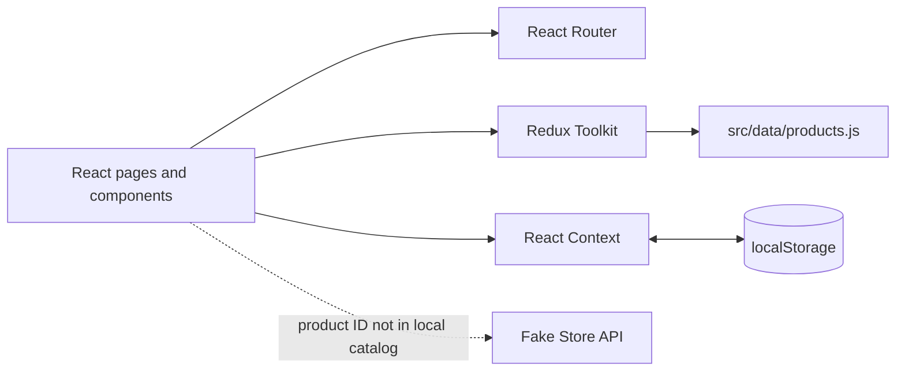

<div align="center">

# SPRINTIX
### Performance gear. Built for the next move.

A polished, responsive sports storefront built as a React portfolio project.
Browse the collection, find gear by category, and try the shopping-bag flow.

<br />

[](https://first-project-react-nu.vercel.app/)
[](https://react.dev/)
[](https://vite.dev/)
[](https://redux-toolkit.js.org/)

<br />

[Features](#-what-you-can-do) · [Architecture](#-under-the-hood) · [Run locally](#-run-it-locally) · [Connect](#-connect)

</div>

---

## The experience

Sprintix is a single-page storefront concept for discovering sports and training essentials. The interface brings together a campaign-style home page, a searchable catalog, individual product pages, a persistent shopping bag, and a client-side sign-in demo.

### ✨ What you can do

- **Explore the storefront** — browse featured products and shop by discipline.
- **Find products quickly** — search names and categories, filter by category, and sort by price or rating.
- **Open a product page** — check its description, rating, and price; choose a quantity and add it to your bag.
- **Manage the bag** — update quantities, remove products, and review the order total.
- **Try the account flow** — switch between sign-in and sign-up with client-side validation.
- **Use it on mobile** — responsive layouts, a keyboard-operable navigation menu, visible focus states, and reduced-motion support.

## 🧭 Under the hood



### Data and state

| Concern | Source of truth | What it handles |
| --- | --- | --- |
| Product catalog | Local `src/data/products.js`, loaded by Redux Toolkit | 12 products and catalog loading/error state |
| Product details | Local catalog first | Requests Fake Store API only when an ID is not in the local catalog |
| Shopping bag | `CartContext` | Items, quantity changes, totals, and browser persistence |
| Demo account | `AuthContext` | A demo username persisted in the browser |
| Page navigation | React Router | Nested layout, catalog, product, cart, login, and not-found routes |

> **Please note:** This is a front-end demo. Sign-in does not authenticate against a server, and checkout does not collect payment or create a real order. Cart and demo-user data are stored in the current browser using `localStorage`.

### Routes

| URL | Page |
| --- | --- |
| `/` | Home |
| `/products` | Product catalog |
| `/products?category=Running` | Catalog filtered by category |
| `/details/:id` | Product details |
| `/cart` | Shopping bag and demo checkout |
| `/login` | Sign-in / sign-up demo |
| Any unmatched path | Not found |

### Technology

| Layer | Stack |
| --- | --- |
| UI | React 18, JSX |
| Tooling | Vite 8 |
| Navigation | React Router DOM 7 |
| Product state | Redux Toolkit, React Redux |
| Cart and demo auth | React Context |
| HTTP | Axios |
| Styling | CSS |
| Hosting | Vercel |

## 🚀 Run it locally

### Prerequisites

- Node.js **20.19+** or **22.12+** (Vite 8 requirement)
- npm
- Git

### Setup

```bash
git clone https://github.com/MoustafaFathalla2005/first-project-react.git
cd first-project-react
npm install
npm run dev
```

Open the local URL printed by Vite (typically `http://localhost:5173`).

### Project scripts

| Command | Purpose |
| --- | --- |
| `npm run dev` | Start the development server with hot reload |
| `npm run build` | Generate the optimized production app in `dist/` |
| `npm run preview` | Serve the production build locally |

Check the production build before deployment:

```bash
npm run build
npm run preview
```

## 📂 Project map

```text
src/
├── api/
│   └── axiosInstance.js             # Axios client for remote product fallback
├── assets/images/                   # Local product and storefront images
├── Component/
│   ├── Cart/                         # Bag, totals, and demo checkout
│   ├── Header/                       # Responsive navigation and account actions
│   ├── Home/                         # Landing page and category entry points
│   ├── Login/                        # Validated client-side account demo
│   ├── MainCom/                      # Shared layout, skip link, and footer
│   ├── NotFound/                     # Fallback route
│   ├── ProductDetails/               # Product page and API fallback
│   └── Products/                     # Catalog, search, filters, and sorting
├── context/
│   ├── AuthContext.jsx               # Demo user state and persistence
│   └── CartContext.jsx               # Shopping-bag state and persistence
├── data/
│   └── products.js                   # Primary local catalog
├── store/
│   ├── productsSlice.js              # Redux Toolkit product state
│   └── store.js                      # Redux store setup
├── index.css                         # Design tokens, shared styles, and motion rules
├── main.jsx                          # App entry point and providers
└── router.jsx                        # Route configuration
```

## ☁️ Deploy

The project is configured for Vercel:

1. Push the repository to GitHub and import it into [Vercel](https://vercel.com).
2. Select the Vite framework preset.
3. Use `npm run build` as the build command and `dist` as the output directory.
4. Deploy.

`vercel.json` rewrites app routes to `index.html`, so React Router can render direct links and refreshed pages.

## 👋 Connect

Built by **Moustafa Fathalla**.

- [GitHub](https://github.com/MoustafaFathalla2005)
- [LinkedIn](https://www.linkedin.com/in/moustafafathalla/)
- [Source repository](https://github.com/MoustafaFathalla2005/first-project-react)
- [Live Sprintix demo](https://first-project-react-nu.vercel.app/)

---

<div align="center">

Made to learn, build, and move forward.

</div>
